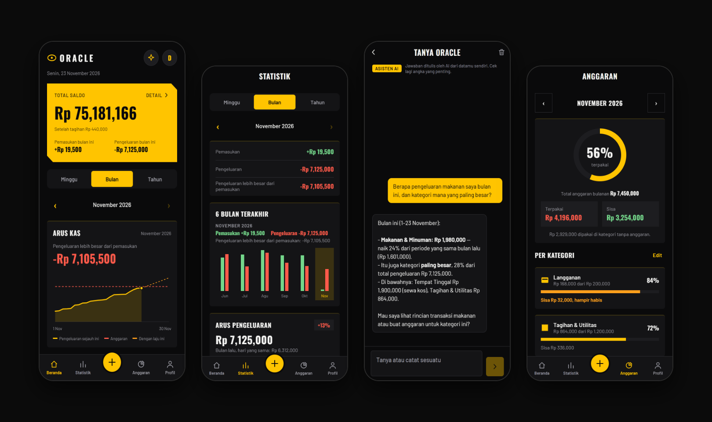
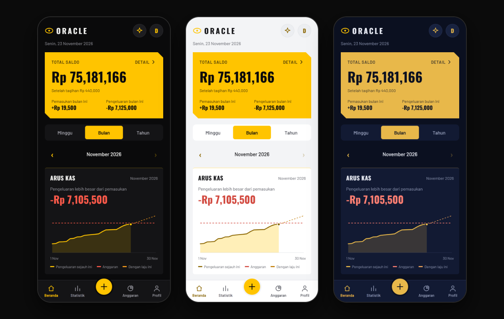
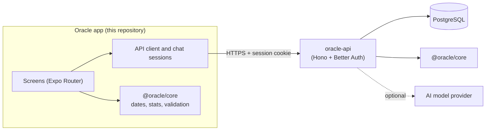

<p align="center">
  
</p>

<h1 align="center">Oracle</h1>

<p align="center">
  Track your money across many banks and e-wallets in one place.<br>
  Your data stays on a server you control. No third-party service reads it.
</p>

<p align="center">
  <a href="https://github.com/Raphonkzy/oracle/releases/tag/v1.0.0"><b>Download the Android APK (1.0.0)</b></a> ·
  <a href="docs/BUILD.md">Build the APK</a> ·
  <a href="docs/DEVELOPMENT.md">Run it locally</a> ·
  <a href="LICENSE">MIT license</a>
</p>



The name and look are inspired by the Oracle of the Batman universe: one place that sees all of your data.

## Features

**Accounts**
- Pick from 87 banks and e-wallets in Indonesia, or create your own account.
- Opening balances, accounts left out of the total, and debts from paylater or credit cards (stored as negative amounts).
- Balance updates: enter the balance you see in your bank app, and the difference is recorded as an adjustment.
- Per-account history with a running balance.

**Transactions**
- Amounts are typed on a number pad. Only digits are accepted, and the amount groups as you type (`1,250,000`).
- Transfers between your accounts. Transfer fees are recorded as expenses.
- **Your usual**: records you enter often appear as quick picks, with the amount you use most.
- 15 default expense categories and 12 income categories, plus your own. Default category names show in the language you chose.
- Search by note, category, or account. Filter by type, account, and date range (quick picks or a calendar).

**Insights**
- Home: total balance (after bills), income and spending, spending by category, and recent transactions. View it by week, month, or year.
- Statistics: spending charts, and a comparison with the same period before. For example, Monday to today against Monday to today last week.
- Budgets per category per month, with warnings at 80% and when a budget is exceeded. Last month's budgets can be copied.
- Insights: short notes from your data, such as a category that went up, your largest transaction, transfer fees, and accounts that have not been updated for a long time. Each note shows the numbers it used.

**Personal settings**
- Languages: English, Bahasa Indonesia, Deutsch, Français, Español, Português, Русский, and 中文. The app follows your phone's language by default and can be changed at any time. English is used for any other language.
- Your own month start: if you are paid on the 20th, your month starts on the 20th. Home, Statistics, Budgets, insights, and the AI assistant count from that day. The default is the 1st.
- A number pad that uses the app's theme for every money field.

**AI assistant** (optional, active when the server has an AI key)
- AI summary on the Statistics screen: a short reading of your numbers for the week, month, or year. If the AI is off or its figures do not check out, the summary comes from plain rules instead.
- **Ask Oracle**: an assistant that always identifies itself as AI. It answers in the language you write in. Ask about your balance, spending, budgets, or bills, ask for an analysis, or type "Add coffee 25000 from BCA" to draft a record. Nothing is saved until you press Confirm.
- Hard rules: the assistant only discusses your money in Oracle. Other questions (poems, code, stocks, exchange rates, and so on) are refused. Numbers in its answers come from your data or from your own message. The assistant cannot change or delete data.

## Themes

Four options under **Profile, Preferences, Appearance**: **Oracle** (black and yellow, the original look), **Oracle Day** (light, with the yellow balance card kept), **Oracle Midnight** (deep blue and gold), and **System** (follows the phone's dark or light mode). The shapes are the same in every theme: cut corners and condensed type for numbers and titles. The logo never changes.

<p align="center">
  
  <br><sub>From left: Oracle, Oracle Day, Oracle Midnight.</sub>
</p>

## How it fits together



The app and the server talk over HTTPS. `@oracle/core` holds the pure logic both use, so the numbers in the app and on the server are always calculated the same way. The server lives in a separate, private repository named `oracle-api`.

## Install

1. Open the [Releases page](https://github.com/Raphonkzy/oracle/releases/tag/v1.0.0) and download `oracle-1.0.0.apk`.
2. Install it on an Android phone. Allow installs from this source if Android asks.
3. Open the app and sign in to the server you use.

The server address is built into the APK, so you do not enter it in the app.

## Quick start for development

```bash
npm install
cp mobile/.env.example mobile/.env     # set the API address for development
npm run android                        # or: npm run web
```

You need a running server. See [docs/DEVELOPMENT.md](docs/DEVELOPMENT.md) for the full steps, and [docs/BUILD.md](docs/BUILD.md) to build the APK or the web version.

## Repository layout

```
oracle/
├─ mobile/       Expo app (Android; also exports to the web)
├─ shared/core/  Pure logic: dates, statistics, validation, category names
├─ docs/         Development and build guides, and README screenshots
└─ LICENSE
```

## Tech stack

| Part | Choice |
|---|---|
| App | React Native, Expo SDK 58, Expo Router |
| Shared logic | Pure TypeScript (`@oracle/core`), tested with `node:test` |
| Server (in `oracle-api`) | Hono, Better Auth, PostgreSQL 18 (production), Drizzle ORM |

## Status

Version 1.0.0. The core features are available and tested: accounts, transactions, transfers, budgets, statistics, insights, and the AI assistant. CSV export exists on the server, but the app does not show it yet ("Soon" on the Profile screen). iOS is not planned.

## License

MIT. See [LICENSE](LICENSE).
